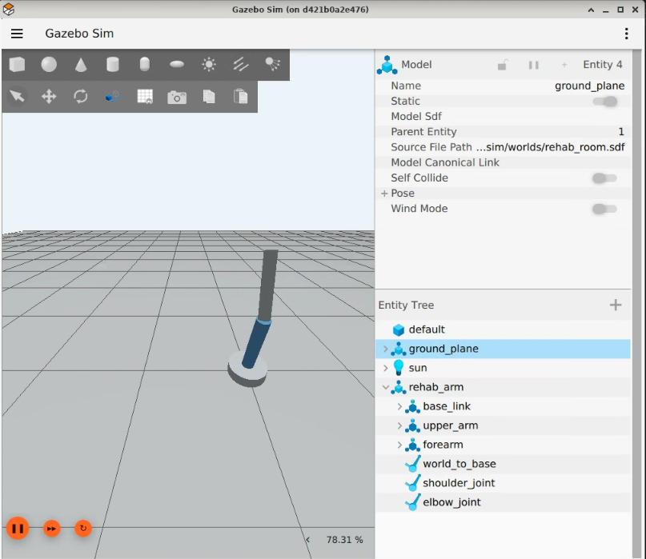
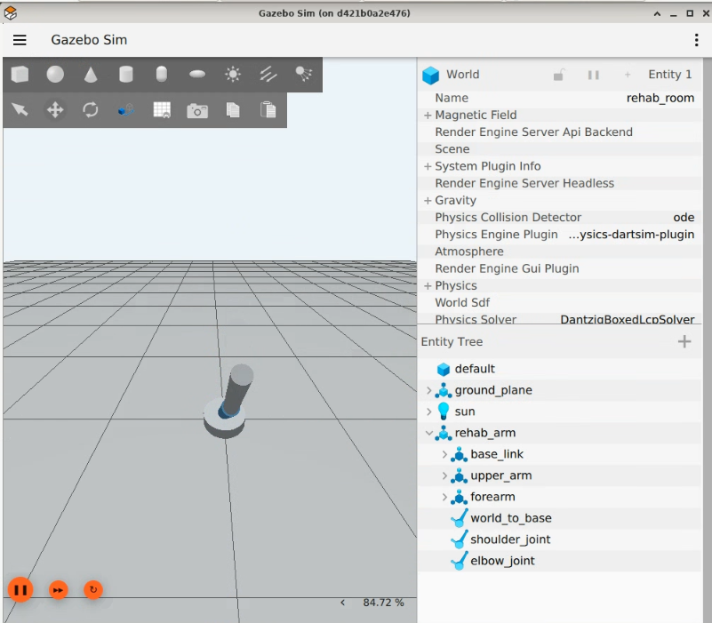

# ros2-rehab-arm-safety-robotics

# Author: Pedro Yanez Melendez

A ROS 2 Jazzy and Gazebo Harmonic simulation of a two-joint rehabilitation robotic arm. The project demonstrates smooth joint control, exercise-session management, measurement and CSV reporting, and a layered runtime safety architecture.

> This is a simulation and software-engineering project. It is not a medical device and must not be used for diagnosis, treatment, or control of real rehabilitation hardware.

## Key Features

- Two-joint shoulder-and-elbow arm modeled in URDF and simulated headlessly in Gazebo Harmonic
- Smooth cosine-based rehabilitation trajectories with endpoint pauses
- Gazebo PID joint-position control and ROS–Gazebo topic bridging
- Live commanded-versus-actual tracking metrics, absolute error, cycle counting, and CSV logging
- Configurable Part 2 sessions with explicit lifecycle states and ROS 2 service controls
- Layered safety monitoring, command clamping, safety margins, and slew-rate limiting
- Docker-oriented host startup scripts for repeatable build and launch workflows

## Architecture / Command Flow

### Part 1

```text
rehab_exercise
    ├── /shoulder_position ─┐
    └── /elbow_position ────┴─> ros_gz_bridge ─> Gazebo PID controllers
                                      │
Gazebo joint states ─> /joint_states ─┴─> exercise_metrics ─> terminal + CSV
```

### Part 2

```text
rehab_session
    ├── desired shoulder/elbow commands
    └── session state (IDLE/RUNNING/PAUSED/COMPLETED/STOPPED/FAULT)
                    │
                    v
          safety_command_gate
          ├── command clamping
          ├── command safety margin
          ├── slew-rate limiting
          └── FAULT command holding
                    │
                    v
       /shoulder_position + /elbow_position
                    │
                    v
             ros_gz_bridge ─> Gazebo
                    │
             /joint_states
              ├── rehab_session safety monitoring
              └── exercise_metrics ─> terminal + CSV
```

## Technologies

- ROS 2 Jazzy and `rclpy`
- Gazebo Harmonic
- `ros_gz_bridge` and `ros_gz_sim`
- Python 3
- URDF and SDF
- `ament_cmake` and `colcon`
- Docker

## Part 1: Automatic Rehabilitation Exercise

Part 1 continuously moves the shoulder between `-0.6` and `+0.6` radians and the elbow between `0.2` and `1.0` radians. Motion is slow and smooth, with pauses at each endpoint.

It includes:

- Gazebo PID position control
- Commanded-versus-actual joint tracking
- Absolute shoulder and elbow error
- Completed-cycle counting
- Elapsed exercise time
- Concise live terminal metrics
- CSV output at `/workspace/rehab_arm_exercise_results.csv`

From the Debian/GCP host:

```bash
cd "/home/pedroeyanezmel531/medical robotics"
./start_part1.sh
```

The script starts the existing `medical-robotics` container if needed, copies the workspace into `/workspace`, builds `rehab_arm_sim`, and launches Part 1. Press `Ctrl+C` to stop and save the results.

## Part 2: Configurable and Safety-Controlled Sessions

Part 2 adds configurable repetitions, exercise speed, shoulder and elbow ranges, and these session states:

```text
IDLE  RUNNING  PAUSED  COMPLETED  STOPPED  FAULT
```

Session controls use ROS 2 `Trigger` services:

```bash
ros2 service call /rehab_session/start std_srvs/srv/Trigger "{}"
ros2 service call /rehab_session/pause std_srvs/srv/Trigger "{}"
ros2 service call /rehab_session/resume std_srvs/srv/Trigger "{}"
ros2 service call /rehab_session/stop std_srvs/srv/Trigger "{}"
ros2 service call /rehab_session/reset_fault std_srvs/srv/Trigger "{}"
```

The safety system provides:

- Physical position limits: shoulder `[-0.80, +0.80]` rad and elbow `[0.00, 1.20]` rad
- Sustained tracking-error monitoring while `RUNNING` or `PAUSED`
- Default maximum tracking error of `0.25` rad for up to `1.0` second
- A dedicated safety command gate as the only Part 2 actuator-command publisher
- A default `0.10` rad command safety margin, producing command limits of shoulder `[-0.70, +0.70]` and elbow `[0.10, 1.10]`
- A configurable default slew-rate limit of `0.5` rad/s
- Immediate transition to `FAULT` on a safety violation, with the last safe actuator commands held until reset

From the Debian/GCP host:

```bash
cd "/home/pedroeyanezmel531/medical robotics"
./start_part2.sh
```

The session starts in `IDLE`. Use the `/rehab_session/start` service from another sourced ROS 2 terminal to begin the exercise.

## Simulation Preview





